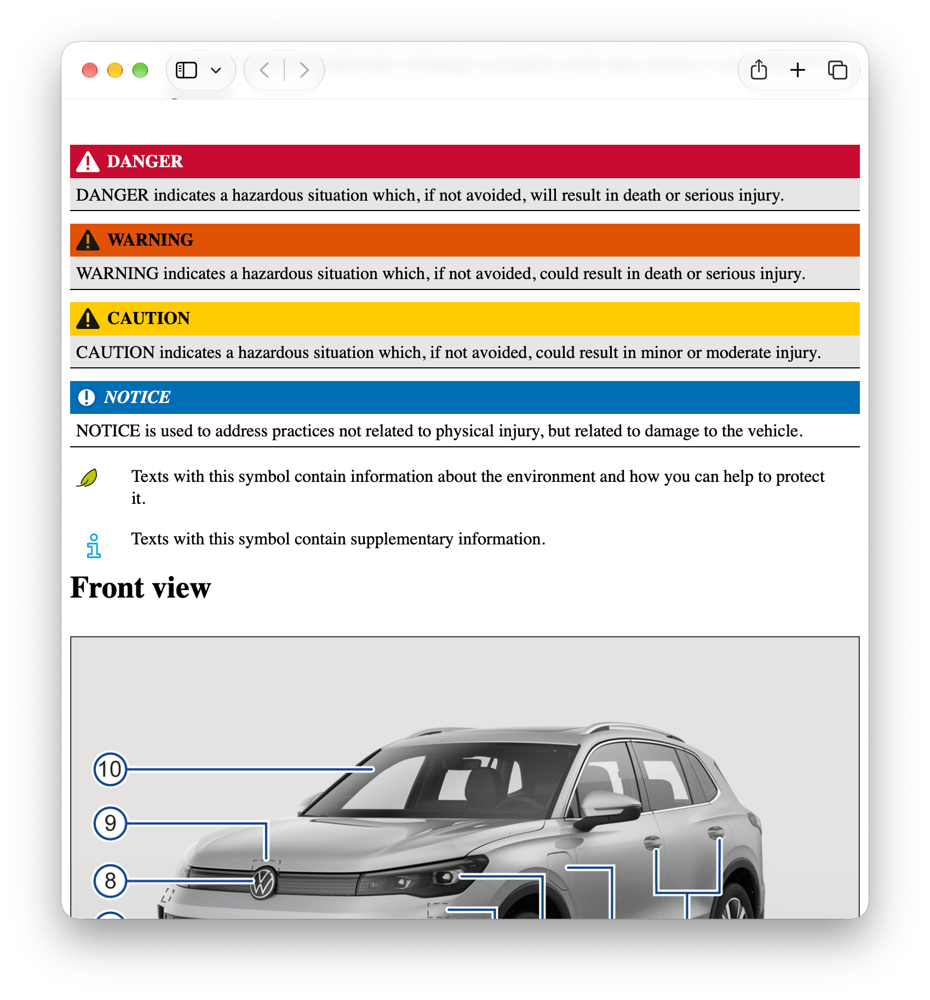

# VW Manual Exporter

Volkswagen hasn't included proper owner's manuals since 2019, nor do they easily
allow you to download a PDF for offline use. Instead, they force you to use an
online web page riddled with bugs, availability issues and tracking.

This tools downloads the manual and allows you to store it as you wish.

## Usage

### Dump

Dump the raw HTML content of the manual pages.

```shell
vw dump --language en_GB --vin <VIN> --output-dir raw-output
```

```text
raw-output
├── 00bcc1f9f551bd370adf02e7216658d5_18_en_GB.html
├── 00f1c33f55c135920adf02e772d4b8fa_21_en_GB.html
...
└── topic-tree.json
```

### Render

Render raw content to a standalone HTML file.

```shell
vw render --input-dir output --format html > output.html
```

You can use your favorite browser to render the HTML to a PDF.

## Demo

The rendered HTML as shown in Safari.


